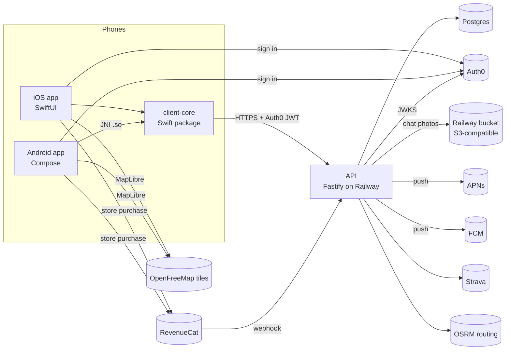

# Architecture

CrewCue is a race-day app for ultrarunners and their crews. The runner's phone sends location pings; every crew phone reads the same progress from the API. Facts behind this page: [generated/modules.md](generated/modules.md), [generated/api-routes.md](generated/api-routes.md), [generated/data-model.md](generated/data-model.md).

## Components

| Component | Path | Role |
| --- | --- | --- |
| API | [services/api](../../services/api) | Fastify + TypeScript ([ADR 0002](../adr/0002-backend-runtime-and-framework.md)). Rooms, pings, projection, pacing, crew chat (messages, photos, push; [ADR 0011](../adr/0011-first-party-crew-chat.md)), Strava, GPX, billing (store purchases via RevenueCat, [billing.md](../api/billing.md)). |
| Contracts | [packages/contracts](../../packages/contracts) | Wire types and parsers. The API imports it; Swift and Kotlin types are generated from it by [generate-client-contracts.mjs](../../scripts/generate-client-contracts.mjs), which fails CI on drift. |
| Map core | [packages/map-core](../../packages/map-core) | GPX/KML parsing, course metrics, course position. API only. |
| Platform client | [packages/platform-client](../../packages/platform-client) | Error catalog and canonical JSON. The API uses only `canonicalJsonStringify`. |
| client-core | [packages/client-core](../../packages/client-core) | One Swift target, no UI ([ADR 0008](../adr/0008-native-clients-with-swift-client-core.md)). API client, outbox, race-day readouts, session, chat sync ([ChatSync.swift](../../packages/client-core/Sources/CrewCueClientCore/ChatSync.swift), [ChatThread.swift](../../packages/client-core/Sources/CrewCueClientCore/ChatThread.swift)). |
| iOS app | [apps/ios](../../apps/ios) | SwiftUI. Links client-core directly. One `@Observable` model + view per screen. |
| Android app | [apps/android](../../apps/android) | Compose. Calls client-core through a JSON op bridge ([RuntimeBridge.swift](../../packages/client-core/Sources/CrewCueClientCore/RuntimeBridge.swift)) compiled to `.so` for arm64-v8a and x86_64. |
| Behavior checklists | [clients/behavior](../../clients/behavior) | Source of truth for iOS/Android parity. `deeplinks.json` status `pass` needs a device proof file. |

## API internals

- **Startup** ([server.ts](../../services/api/src/server.ts)): validates persistence and auth env, starts OTel tracing if `OTEL_EXPORTER_OTLP_ENDPOINT` is set, starts Sentry error reporting and crash handlers if `SENTRY_DSN` is set ([errorReporting.ts](../../services/api/src/lib/errorReporting.ts)), builds the app, starts the chat retention scheduler.
- **Plugins** ([app.ts](../../services/api/src/app.ts)): `auth` → `audit` → `rateLimit`, then 17 route modules. Body limit 32 MB.
- **Auth** ([plugins/auth.ts](../../services/api/src/plugins/auth.ts)): a global `preHandler` verifies the Bearer token (Auth0 RS256 via JWKS, or HS256 `JWT_SECRET` outside production) and sets `request.identity`. It never rejects; each handler returns 401 when `identity` is missing. This is opt-in auth: a new route is open unless its handler checks.
- **Authorization**: roles come from the room document (`room.memberships[].role`), not the JWT. Helpers `requireRoomMember` and `requireCourseEditor` in [raceRooms.ts](../../services/api/src/routes/raceRooms.ts); most handlers check membership inline. Paid features also go through `evaluateEntitlement`. Crew invites, invite accepts, and code joins are refused with 409 `crew_limit_reached` past the room's crew tier ([raceRooms.ts](../../services/api/src/routes/raceRooms.ts:3155), [billingEntitlement.ts](../../services/api/src/lib/billingEntitlement.ts:57)).
- **Persistence**: `PERSISTENCE_MODE=memory` (default) or `postgres`. Rooms are whole JSON documents (`race_rooms_json.payload`) plus per-feature JSON snapshot tables. Append-only tables: `room_athlete_pings`, `platform_domain_events`. Five separate `pg.Pool`s, one per store.
- **Concurrency**: room reads go through in-process caches; writes serialize on in-process locks (`withRoomRuntimeLock`, `commitRaceRoomUpdate`). Correct for one instance only. See [risks.md](risks.md) R1.
- **Chat**: messages live in `chat_messages` ([0018 migration](../../services/api/db/migrations/0018_first_party_chat.sql), [chatMessageStore.ts](../../services/api/src/lib/chatMessageStore.ts)). Long-poll wake-ups are an in-process map ([chatLive.ts](../../services/api/src/lib/chatLive.ts)). Photos go to an S3-compatible bucket signed by a small SigV4 helper ([chatPhotoStore.ts](../../services/api/src/lib/chatPhotoStore.ts), [s3Presign.ts](../../services/api/src/lib/s3Presign.ts)); outside production an in-memory store stands in, and production without a bucket has no photos. Push goes straight to APNs and FCM when configured, otherwise to a logging transport ([chatPushTransports.ts](../../services/api/src/lib/chatPushTransports.ts), [chatPushDispatch.ts](../../services/api/src/lib/chatPushDispatch.ts)). There is no chat vendor: [verify-no-vendor-chat.mjs](../../scripts/verify-no-vendor-chat.mjs) (part of `verify:clients`) fails if Stream Chat comes back into the apps, client-core, contracts, or API.
- **Billing**: [billingRoutes.ts](../../services/api/src/routes/billingRoutes.ts) serves the RevenueCat webhook (shared `Authorization` secret), an admin comp (`x-crewcue-billing-admin-secret`), the members-only `GET /race-rooms/:roomId/billing`, and a debug fake purchase. Grants live in `billing_grants`, deliveries in `billing_webhook_events` ([0019 migration](../../services/api/db/migrations/0019_billing_grants.sql), [billingStore.ts](../../services/api/src/lib/billingStore.ts)); the room's entitlement is recomputed from all its grants under the room lock ([billingRoutes.ts](../../services/api/src/routes/billingRoutes.ts:45)). Hand-set entitlement and the fake purchase are refused when `NODE_ENV=production` unless `BILLING_MANUAL_ENTITLEMENT=enabled` ([billingEnv.ts](../../services/api/src/lib/billingEnv.ts)).
- **Idempotency**: `Idempotency-Key` header on room create, course PUT, manual stop, stop plans ([httpIdempotency.ts](../../services/api/src/lib/httpIdempotency.ts)); 24 h TTL, 5 min lease.

## Client internals

- **Single network stack**: `URLSessionTransport` in [APIClient.swift](../../packages/client-core/Sources/CrewCueClientCore/APIClient.swift). Android HTTP also runs through it via the bridge. [verify-client-boundary.mjs](../../scripts/verify-client-boundary.mjs) fails if client-core imports UI/vendor SDKs or an app grows its own outbox or HTTP client.
- **Outbox**: [OutboxStore.swift](../../packages/client-core/Sources/CrewCueClientCore/OutboxStore.swift) is a file-backed actor (`outbox.json`, `ping-watermarks.json`). [Outbox.swift](../../packages/client-core/Sources/CrewCueClientCore/Outbox.swift) maps HTTP results to retry/drop/accept. Chat messages now flush through it too, in queue order ([OutboxStore.swift](../../packages/client-core/Sources/CrewCueClientCore/OutboxStore.swift:447)).
- **Chat**: both apps run chat on our API through client-core `ChatSync` (long-poll reads with a hard [Deadline.swift](../../packages/client-core/Sources/CrewCueClientCore/Deadline.swift) timeout, outbox sends, photo upload). iOS calls it from [ChatModel.swift](../../apps/ios/CrewCue/Screens/Chat/ChatModel.swift); Android calls the `chatPoll`/`chatSend`/`chatUploadPhoto`/`chatOlder`/`chatDiscard` bridge ops ([RuntimeChat.swift](../../packages/client-core/Sources/CrewCueClientCore/RuntimeChat.swift), [RaceDayBridge.kt](../../apps/android/app/src/main/kotlin/com/crewcue/android/data/RaceDayBridge.kt:204), [ChatViewModel.kt](../../apps/android/app/src/main/kotlin/com/crewcue/android/ui/chat/ChatViewModel.kt)).
- **Session**: Auth0 web sign-in in each app; the token goes into a static provider. A 401 calls `SessionController.expire()`, which wipes every per-user store ([Session.swift](../../packages/client-core/Sources/CrewCueClientCore/Session.swift)).
- **Vendor SDKs stay in the apps**: MapLibre, Auth0, Firebase Cloud Messaging (Android; push works only when the build has `google-services.json`, [build.gradle.kts](../../apps/android/app/build.gradle.kts:27), [CrewPush.kt](../../apps/android/app/src/main/kotlin/com/crewcue/android/ui/chat/CrewPush.kt)), RevenueCat ([RevenueCatPurchaser.swift](../../apps/ios/CrewCue/App/RevenueCatPurchaser.swift), [RevenueCatPurchaser.kt](../../apps/android/app/src/main/kotlin/com/crewcue/android/billing/RevenueCatPurchaser.kt)). A build without a RevenueCat key cannot buy; debug builds can use a fake store that calls the dev purchase route ([StorePurchaser.swift](../../apps/ios/CrewCue/App/StorePurchaser.swift)).

## Deployment

- **Railway** hosts the API and Postgres ([railway.toml](../../railway.toml), [ADR 0009](../adr/0009-railway-hosting.md)). `staging` and `production` environments, each with its own Postgres.
- Every merge to `main` deploys staging. Production deploys only from the tag-triggered [release.yml](../../.github/workflows/release.yml), behind the `release` environment's owner approval ([launch-owner-setup.md](../runbooks/launch-owner-setup.md)).
- `preDeployCommand` runs `npm run db:migrate`: every `.sql` in [db/migrations](../../services/api/db/migrations) in order, idempotent DDL, no ledger. Health check `/health/live`.
- Mobile releases: TestFlight and Play internal track from the same release workflow.

## CI gates

[ci.yml](../../.github/workflows/ci.yml): `pr-decision-doc-guard` (PR body template), `dual-client-guard` (`verify:clients`), `checks` (lint, typecheck, build, test, harness tests, `kb:check`, Swift client-core), `api-postgres-integration`, path-filtered `ios` and `android` device smoke. [security.yml](../../.github/workflows/security.yml): dependency review, gitleaks; weekly `npm audit`. [codeql.yml](../../.github/workflows/codeql.yml). Daily [staging-smoke.yml](../../.github/workflows/staging-smoke.yml). [kb-refresh.yml](../../.github/workflows/kb-refresh.yml) regenerates `docs/kb` on pushes to `main` and weekly, reconciles these pages with Claude Code, and opens an auto-merging PR that may touch only `docs/kb/**`; it skips when `ANTHROPIC_API_KEY` is unset.

## Decisions

| ADR | Decision |
| --- | --- |
| [0002](../adr/0002-backend-runtime-and-framework.md) | Node + TypeScript + Fastify. |
| [0003](../adr/0003-canonical-data-and-event-log.md) | Postgres, append-only domain events, idempotency keys. |
| [0005](../adr/0005-delivery-observability-security-slos.md) | Required checks, OTel, SLOs: 99.9% availability, P95 < 350 ms. |
| [0007](../adr/0007-mvp-plaintext-crew-chat.md) | Plaintext chat on Stream. E2E chat ([0006](../adr/0006-practical-e2e-crew-chat.md)) retired. Superseded by 0011. |
| [0008](../adr/0008-native-clients-with-swift-client-core.md) | Native SwiftUI + Compose over a shared Swift core. Expo removed. |
| [0009](../adr/0009-railway-hosting.md) | Railway for API and Postgres. AWS Terraform removed. |
| [0010](../adr/0010-crash-reporting-sentry.md) | Sentry for crash and error reporting, errors only, scrubbed. |
| [0011](../adr/0011-first-party-crew-chat.md) | First-party chat in Postgres, long-poll live updates, photos in a Railway bucket, direct APNs/FCM push. Stream removed in #673. |
