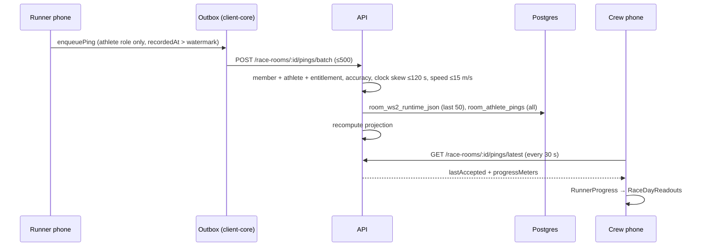

# Data flow

End-to-end paths for the flows that matter on race day. Routes and guards: [generated/api-routes.md](generated/api-routes.md). Tables: [generated/data-model.md](generated/data-model.md).

## 1. Runner location → crew readouts

The product invariant: progress comes from the **runner's phone**, never a crew phone's GPS ([AGENTS.md](../../AGENTS.md)).

1. **Capture.** iOS `RaceTrackingLocator` (Always authorization, background location mode) or Android `RaceTrackingService` (location foreground service). `PingPolicy.mayUpload` allows only the athlete role; `LocationUploadGate` throttles. Code: [RaceTracking.swift](../../packages/client-core/Sources/CrewCueClientCore/RaceTracking.swift), [LocationUploadGate.swift](../../packages/client-core/Sources/CrewCueClientCore/LocationUploadGate.swift).
2. **Queue.** [OutboxStore.swift](../../packages/client-core/Sources/CrewCueClientCore/OutboxStore.swift) persists pings to disk with a per-room `recordedAt` watermark. Cap 2000 pending per room; oldest dropped beyond that.
3. **Upload.** `RaceDayAPI.flushOutbox` posts batches. 422 `stale_recorded_at` → dropped; network error → stays pending; 401 → session expired ([Outbox.swift](../../packages/client-core/Sources/CrewCueClientCore/Outbox.swift)).
4. **Ingest.** `POST /race-rooms/:roomId/pings` and `/pings/batch` in [raceRooms.ts](../../services/api/src/routes/raceRooms.ts). Under the room runtime lock: monotonic `recordedAt`, speed gate, then the WS2 snapshot (last 50 pings), `room_athlete_pings` (`ON CONFLICT DO NOTHING`, so replays are idempotent; [athletePingTrack.ts](../../services/api/src/lib/athletePingTrack.ts)), projection recompute.
5. **Read.** `GET /race-rooms/:roomId/pings/latest` serves the in-memory last accepted ping and projected progress. `GET …/pings/track` pages the durable table (≤2000).
6. **Render.** `RaceDayAPI.latestPing` → `RunnerProgress` → `RaceDayReadouts.make` ([RaceDayReadout.swift](../../packages/client-core/Sources/CrewCueClientCore/RaceDayReadout.swift)). A ping older than 15 min is stale and drops the on-track call.

## 2. Projection and pacing

- **Pre-race estimate.** `POST /pacing-estimates` ([pacingEstimates.ts](../../services/api/src/routes/pacingEstimates.ts)): `decidePlanAuthority` picks whose history counts; inputs are activity history, finished efforts, and the course-history cohort; the micro-model runs synchronously ([pacingEstimate/microModel](../../services/api/src/lib/pacingEstimate/microModel)); result saved.
- **Plan of record.** `PUT /race-rooms/:roomId/pacing-estimate` ([raceRoomSchedule.ts](../../services/api/src/routes/raceRoomSchedule.ts)) attaches an estimate to the room and refreshes the projection. `GET …/schedule` serves the stop schedule.
- **Live projection.** Each accepted ping runs `recomputeProjectionForSamples` → [raceProjection.ts](../../services/api/src/lib/raceProjection.ts). The ping is placed on the course with `geodesicProjectPointToPolylineNearProgress` ([courseMetrics.ts](../../packages/map-core/src/courseMetrics.ts:154), called at [raceProjection.ts](../../services/api/src/lib/raceProjection.ts:404)): on ground the route covers twice (loop finish, out-and-back) it picks the stretch nearest the expected progress (last progress plus time since the previous ping at the faster of rolling speed and plan pace); elsewhere it keeps the plain nearest point. With `PROJECTION_TUNED_CONSTANTS` on, it blends the course-history cohort ([courseHistory/resolve.ts](../../services/api/src/lib/courseHistory/resolve.ts), 5 min cache) and adds arrival windows ([arrivalWindows.ts](../../services/api/src/lib/arrivalWindows.ts)).
- **Finish.** The first finish crossing records a finished effort and a CrewCue course-history entry, which feed later estimates.

## 3. Chat and push

The API holds first-party chat ([ADR 0011](../adr/0011-first-party-crew-chat.md)); both apps use it and the Stream routes are gone ([verify-no-vendor-chat.mjs](../../scripts/verify-no-vendor-chat.mjs)).

- **Client (iOS).** [ChatModel.swift](../../apps/ios/CrewCue/Screens/Chat/ChatModel.swift) loops on client-core `ChatSync.poll`: the first call loads the newest page, then each call long-polls with `after` and `wait=25` under a hard deadline, flushes any queued chat, and backs off 1–30 s after failures ([ChatSync.swift](../../packages/client-core/Sources/CrewCueClientCore/ChatSync.swift:41), [Deadline.swift](../../packages/client-core/Sources/CrewCueClientCore/Deadline.swift), `ChatReconnectPolicy` in [ChatThread.swift](../../packages/client-core/Sources/CrewCueClientCore/ChatThread.swift:171)). `ChatSync.send` queues the message under its `clientMessageId` (`enqueueChat`, [OutboxStore.swift](../../packages/client-core/Sources/CrewCueClientCore/OutboxStore.swift:147)) and flushes; the outbox posts it to the messages route, and 413/415 count as rejected ([Outbox.swift](../../packages/client-core/Sources/CrewCueClientCore/Outbox.swift:127)). Photos upload first, then send with the returned `photoKey`. Photos render in a fixed frame with loading and failure states, and the thread stays on the newest message ([ChatView.swift](../../apps/ios/CrewCue/Screens/Chat/ChatView.swift)).
- **Client (Android).** [ChatViewModel.kt](../../apps/android/app/src/main/kotlin/com/crewcue/android/ui/chat/ChatViewModel.kt:62) loops on the `chatPoll` bridge op, which runs the same `ChatSync.poll` and returns rows plus `retryAfterSeconds`; a failed bridge call waits 30 s. Sends, photo uploads, older pages, and discards go through `chatSend`, `chatUploadPhoto`, `chatOlder`, `chatDiscard` ([RuntimeChat.swift](../../packages/client-core/Sources/CrewCueClientCore/RuntimeChat.swift:81), [RaceDayBridge.kt](../../apps/android/app/src/main/kotlin/com/crewcue/android/data/RaceDayBridge.kt:204)). Photos use a fixed 220×165 dp frame and the thread scrolls to the newest message ([ChatPhotoLayout.kt](../../apps/android/app/src/main/kotlin/com/crewcue/android/ui/chat/ChatPhotoLayout.kt:10)). Debug builds allow cleartext to the emulator host so photo loads reach a local API ([network_security_config.xml](../../apps/android/app/src/debug/res/xml/network_security_config.xml)).

- **Send.** `POST /chat/rooms/:roomId/messages` (room member; text ≤4000 chars and/or a photo key) inserts into `chat_messages`. `(room, sender, clientMessageId)` is unique, so a retry returns the first message with `duplicate: true` ([chatRoutes.ts](../../services/api/src/routes/chatRoutes.ts:302), [chatMessageStore.ts](../../services/api/src/lib/chatMessageStore.ts), [contracts](../../packages/contracts/src/index.ts:1063)). On Postgres each insert takes a per-room advisory lock inside its transaction, so ids and commit order match and a polling phone's `after` cursor cannot skip a message ([chatMessageStore.ts](../../services/api/src/lib/chatMessageStore.ts:152)). A new message wakes long-polls and schedules push.
- **Read.** `GET /chat/rooms/:roomId/messages` pages by `before`/`after` cursors (bigserial ids, ordered on the numeric `chat_messages.seq` column because the selected `seq` alias is text and would sort "100" before "99"; [chatMessageStore.ts](../../services/api/src/lib/chatMessageStore.ts:109), [chatMessageStore.ts](../../services/api/src/lib/chatMessageStore.ts:184)). With `after` and `wait` (≤25 s) it parks until a message lands, the caller is removed from the room (then 403), or the wait ends ([chatRoutes.ts](../../services/api/src/routes/chatRoutes.ts:239)). Wake-ups are in-process ([chatLive.ts](../../services/api/src/lib/chatLive.ts)); member removal publishes one, including removal by account deletion ([raceRooms.ts](../../services/api/src/routes/raceRooms.ts:3530), [raceRooms.ts](../../services/api/src/routes/raceRooms.ts:1790)).
- **Photos.** `POST /chat/rooms/:roomId/photos` takes raw JPEG/PNG/HEIC/WebP bytes up to 10 MB and returns a key scoped to room and sender; messages return presigned GET URLs that expire after 1 h ([chatRoutes.ts](../../services/api/src/routes/chatRoutes.ts:346), [chatPhotoStore.ts](../../services/api/src/lib/chatPhotoStore.ts)). Without a bucket, production answers 503; dev reads go through `GET /chat/photos/*` with a signed `exp`/`sig`.
- **Push.** Devices register with `POST /chat/devices` (alias `/chat/push/tokens`), iOS with its APNs gateway ([chatRoutes.ts](../../services/api/src/routes/chatRoutes.ts:384)); clients queue tokens through the outbox (`enqueuePush`, [OutboxStore.swift](../../packages/client-core/Sources/CrewCueClientCore/OutboxStore.swift:274)). iOS sends `apnsEnvironment` (`development` in Debug, `production` otherwise, matching [CrewCue.entitlements](../../apps/ios/CrewCue.entitlements)) and re-registers silently on sign-in when notifications are already allowed ([PushRegistrationModel.swift](../../apps/ios/CrewCue/Screens/Chat/PushRegistrationModel.swift), [ShellModel.swift](../../apps/ios/CrewCue/App/ShellModel.swift)). Tapping a chat push (`type: chat`, `roomId`) switches to that race and opens its chat ([RemoteNotifications.swift](../../apps/ios/CrewCue/App/RemoteNotifications.swift)). Android gets an FCM token (only when Firebase is configured), queues it with `enqueuePush`, re-registers on launch and on token rotation, shows foreground chat pushes itself, and routes a tap to the race's chat ([CrewPush.kt](../../apps/android/app/src/main/kotlin/com/crewcue/android/ui/chat/CrewPush.kt:70), [MainActivity.kt](../../apps/android/app/src/main/kotlin/com/crewcue/android/MainActivity.kt:49), [ShellViewModel.kt](../../apps/android/app/src/main/kotlin/com/crewcue/android/ui/ShellViewModel.kt:231)). Recipients are filtered by prefs (`all`/`mentions`/`none`) and sent through APNs (token `.p8`, HTTP/2) or FCM HTTP v1; 429/5xx retry, dead tokens are reported for deletion ([chatPushTransports.ts](../../services/api/src/lib/chatPushTransports.ts)). Platforms without credentials fall back to a logging transport ([chatPushDispatch.ts](../../services/api/src/lib/chatPushDispatch.ts)). Check-in ETA alerts use the same dispatch ([checkInEtaNotify.ts](../../services/api/src/lib/checkInEtaNotify.ts)). Setup: [chat-push.md](../runbooks/chat-push.md).
- **Retention.** A 6 h in-process interval deletes a room's messages, their bucket photos, and its prefs 30 days after `eventEndsAt` ([chatRetentionScheduler.ts](../../services/api/src/lib/chatRetentionScheduler.ts), [chatPersistence.ts](../../services/api/src/lib/chatPersistence.ts:255), [chat-retention.md](../runbooks/chat-retention.md)). The race owner can do the same with `DELETE /chat/rooms/:roomId/messages`.

## 4. Activity import, Strava, GPX, course history

- **Activity files**: `POST /activity-history/file` takes a base64 GPX, FIT, or TCX file (10 MB cap, content-hash dedupe), parsed by map-core into one activity summary ([activityHistory.ts](../../services/api/src/routes/activityHistory.ts)). This is v1's way to bring in history. iOS: Settings → Past runs picks a file, checks it locally, then calls `RaceDayAPI.importActivityFile` and reloads `activityHistoryItems` ([ActivityImportModel.swift](../../apps/ios/CrewCue/Screens/ActivityImport/ActivityImportModel.swift), [RaceDayAPI.swift](../../packages/client-core/Sources/CrewCueClientCore/RaceDayAPI.swift:197)); Android: Settings → Past runs opens the system document picker, reads at most one byte past the size limit (so client-core reports an oversized file), then calls the `importActivityFile` and `activityHistoryItems` bridge ops ([ActivityImportSection.kt](../../apps/android/app/src/main/kotlin/com/crewcue/android/ui/activity/ActivityImportSection.kt:94), [RaceDayBridge.kt](../../apps/android/app/src/main/kotlin/com/crewcue/android/data/RaceDayBridge.kt:261), [RuntimeBridge.swift](../../packages/client-core/Sources/CrewCueClientCore/RuntimeBridge.swift:1397)).
- **Strava** (off in v1 clients behind `ClientFeatureFlags.stravaEnabled`; on Android behind `BuildConfig.STRAVA_ENABLED`, on only with `-Pcrewcue.strava=true` ([build.gradle.kts](../../apps/android/app/build.gradle.kts:79), [SettingsSheet.kt](../../apps/android/app/src/main/kotlin/com/crewcue/android/ui/settings/SettingsSheet.kt:63); API routes still live) ([stravaRoutes.ts](../../services/api/src/routes/stravaRoutes.ts)): OAuth with a per-user state; `/strava/oauth/redirect` bounces to the `crewcue://strava` deep link; the callback stores tokens; `/strava/sync` refreshes and upserts activities into activity history.
- **GPX**: `/activity-history/gpx` and `/course/gpx-preview` take up to 10 MB ([gpxLimits.ts](../../services/api/src/lib/gpxLimits.ts)); parsed synchronously in [map-core courseParse.ts](../../packages/map-core/src/courseParse.ts). Clients queue imports in the outbox.
- **Course history**: OpenSplitTime results come in through operator scripts ([sources/openSplitTime.ts](../../services/api/src/lib/courseHistory/sources/openSplitTime.ts)); `COURSE_HISTORY_PRODUCT_SOURCES` picks which sources the product uses.

## 5. Rooms, invites, join

- **Create**: `POST /race-rooms` with `Idempotency-Key`; room id derived from sub + key. The creator becomes the first member with the role they choose.
- **Invite**: an inviter (athlete, crew chief, team manager) creates a UUID token, 24 h default. Only the race owner (the room's `athleteId`) may invite above `crew_member`; any other issuer gets 403 ([raceRooms.ts](../../services/api/src/routes/raceRooms.ts:3146)). Accept adds or changes the caller's membership under the room lock.
- **Join by code**: any signed-in user with the 6-digit code joins as `crew_member`. `GET /race-rooms/join-preview/:roomCode` is public and rate-limited per IP.
- **Crew cap**: new rooms start `unpaid` with crew tier `one`. Rooms stored before billing have no tier and count as unlimited. The runner and the room's creator do not take the crew seat. Past the cap, crew invites, invite accepts, and code joins answer 409 `crew_limit_reached`; accepts and joins check under the room lock. Existing members are never removed ([raceRooms.ts](../../services/api/src/routes/raceRooms.ts:3155), [billingEntitlement.ts](../../services/api/src/lib/billingEntitlement.ts:29)).

## 6. Auth

Auth0 web sign-in on the phone → access token → `Authorization: Bearer` on every client-core request → API verifies against Auth0 JWKS → `request.identity` = {sub, email, teamIds, roomRoles} ([authIdentity.ts](../../services/api/src/lib/authIdentity.ts)). No refresh token on the clients today; a 401 expires the session and wipes per-user stores.

## 7. Account deletion

Settings → Delete account → confirm → `AccountDeletion.run` → `RaceDayAPI.deleteAccount` → `DELETE /me` ([AccountDeletion.swift](../../packages/client-core/Sources/CrewCueClientCore/AccountDeletion.swift), [RaceDayAPI.swift](../../packages/client-core/Sources/CrewCueClientCore/RaceDayAPI.swift:496), [accountRoutes.ts](../../services/api/src/routes/accountRoutes.ts:17)). Only a confirmed delete signs the app out, which wipes the session, outbox and per-user caches; offline, 502 (data gone, Auth0 login not removed) and other failures keep the user signed in to retry. iOS calls it from [AccountDeletionModel.swift](../../apps/ios/CrewCue/Screens/Settings/AccountDeletionModel.swift); Android calls it from the Settings Account card ([AccountDeletion.kt](../../apps/android/app/src/main/kotlin/com/crewcue/android/ui/settings/AccountDeletion.kt:99), [SettingsSheet.kt](../../apps/android/app/src/main/kotlin/com/crewcue/android/ui/settings/SettingsSheet.kt:78)) through the `deleteAccount` bridge op and takes its strings from the `accountDeletionCopy` op ([RaceDayBridge.kt](../../apps/android/app/src/main/kotlin/com/crewcue/android/data/RaceDayBridge.kt:286), [RuntimeBridge.swift](../../packages/client-core/Sources/CrewCueClientCore/RuntimeBridge.swift:231)); its web link is the `ACCOUNT_DELETION_URL` build field ([build.gradle.kts](../../apps/android/app/build.gradle.kts:75)). Spec: [account-deletion.md](../../clients/behavior/account-deletion.md). On the server, rooms the user owns lose their chat messages and photos; every message the user sent in any room goes with its photo, as do their push devices and prefs ([accountDeletion.ts](../../services/api/src/lib/accountDeletion.ts:101), [chatPersistence.ts](../../services/api/src/lib/chatPersistence.ts:290), [chatMessageStore.ts](../../services/api/src/lib/chatMessageStore.ts:251)). There is no third-party chat user to delete any more. Billing grants stay for refunds and store reconciliation; only their link to the user is removed (`anonymizeBillingForUser`, [accountDeletion.ts](../../services/api/src/lib/accountDeletion.ts:95), [billingStore.ts](../../services/api/src/lib/billingStore.ts:227)).

## 8. Billing

The runner pays per race; crew never pay ([billing.md](../api/billing.md)). Products are consumables: `race_pass` (runner + 1 crew), `crew_upgrade` (unlimited crew once the room has a pass), `race_pass_full_crew` ([billingEntitlement.ts](../../services/api/src/lib/billingEntitlement.ts:16)).

1. **Buy.** The app sets the RevenueCat subscriber attribute `crewcue_room_id` to the room and buys through the store ([RevenueCatPurchaser.swift](../../apps/ios/CrewCue/App/RevenueCatPurchaser.swift:31), [RevenueCatPurchaser.kt](../../apps/android/app/src/main/kotlin/com/crewcue/android/billing/RevenueCatPurchaser.kt:66)). The apps never mark a room paid.
2. **Webhook.** `POST /billing/revenuecat` checks the `Authorization` header against `REVENUECAT_WEBHOOK_AUTH` (503 when unset), records the delivery by event id so redeliveries are no-ops, and maps purchase events to grants and `CANCELLATION`/`EXPIRATION` to revokes ([billingRoutes.ts](../../services/api/src/routes/billingRoutes.ts:92), [billingEntitlement.ts](../../services/api/src/lib/billingEntitlement.ts:156)). A purchase with no room attribute, or an unknown room, is stored with `room_id` null and logged as `billing_webhook_unknown_room`, never applied ([billingRoutes.ts](../../services/api/src/routes/billingRoutes.ts:126)). If applying fails, the delivery record is dropped so RevenueCat's retry applies it.
3. **Apply.** Under the room lock, the grant is upserted by transaction id and the room's entitlement is recomputed from all its grants: an active pass makes it `paid`, a pass plus Full Crew makes the tier `unlimited`, a refund drops it back ([billingRoutes.ts](../../services/api/src/routes/billingRoutes.ts:45), [billingEntitlement.ts](../../services/api/src/lib/billingEntitlement.ts:114)).
4. **Confirm.** After the store reports a purchase, client-core polls `GET /race-rooms/:roomId/billing` (20 reads, 2 s apart) until the room has the product. If the webhook has not landed by then, the purchase ends `pending`, not failed ([Billing.swift](../../packages/client-core/Sources/CrewCueClientCore/Billing.swift:127), [Billing.swift](../../packages/client-core/Sources/CrewCueClientCore/Billing.swift:222)). Android runs the same flow through the `billing` and purchase bridge ops ([RuntimeBridge.swift](../../packages/client-core/Sources/CrewCueClientCore/RuntimeBridge.swift:90), [RaceDayBridge.kt](../../apps/android/app/src/main/kotlin/com/crewcue/android/data/RaceDayBridge.kt:318)).
5. **Comp.** Race directors' rooms are comped with `npm run billing:comp`, which calls `POST /billing/admin/comp` with a server secret the apps never hold ([billing-comp.mjs](../../scripts/billing-comp.mjs), [billingRoutes.ts](../../services/api/src/routes/billingRoutes.ts:198)).
