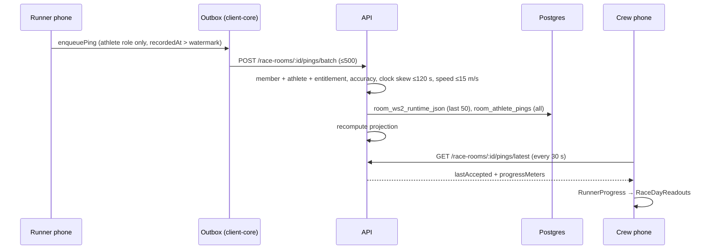

# Data flow

End-to-end paths for the flows that matter on race day. Routes and guards: [generated/api-routes.md](generated/api-routes.md). Tables: [generated/data-model.md](generated/data-model.md).

## 1. Runner location → crew readouts

The product invariant: progress comes from the **runner's phone**, never a crew phone's GPS ([AGENTS.md](../../AGENTS.md)).

1. **Capture.** iOS `RaceTrackingLocator` (Always authorization, background location mode) or Android `RaceTrackingService` (location foreground service). `PingPolicy.mayUpload` allows only the athlete role; `LocationUploadGate` throttles. Code: [RaceTracking.swift](../../packages/client-core/Sources/CrewCueClientCore/RaceTracking.swift), [LocationUploadGate.swift](../../packages/client-core/Sources/CrewCueClientCore/LocationUploadGate.swift).
2. **Queue.** [OutboxStore.swift](../../packages/client-core/Sources/CrewCueClientCore/OutboxStore.swift) persists pings to disk with a per-room `recordedAt` watermark. Cap 2000 pending per room; oldest dropped beyond that.
3. **Upload.** `RaceDayAPI.flushOutbox` posts batches. 422 `stale_recorded_at` → dropped; network error → stays pending; 401 → session expired ([Outbox.swift](../../packages/client-core/Sources/CrewCueClientCore/Outbox.swift)).
4. **Ingest.** `POST /race-rooms/:roomId/pings` and `/pings/batch` in [raceRooms.ts](../../services/api/src/routes/raceRooms.ts). Under the room runtime lock: monotonic `recordedAt`, speed gate, then the WS2 snapshot (last 50 pings), `room_athlete_pings` (`ON CONFLICT DO NOTHING`, so replays are idempotent; [athletePingTrack.ts](../../services/api/src/lib/athletePingTrack.ts)), projection recompute.
5. **Read.** `GET /race-rooms/:roomId/pings/latest` serves the in-memory last accepted ping and projected progress. `GET …/pings/track` pages the durable table (≤2000).
6. **Render.** `RaceDayAPI.latestPing` → `RunnerProgress` → `RaceDayReadouts.make` ([RaceDayReadout.swift](../../packages/client-core/Sources/CrewCueClientCore/RaceDayReadout.swift)). A ping older than 15 min is stale and drops the on-track call.

## 2. Projection and pacing

- **Pre-race estimate.** `POST /pacing-estimates` ([pacingEstimates.ts](../../services/api/src/routes/pacingEstimates.ts)): `decidePlanAuthority` picks whose history counts; inputs are activity history, finished efforts, and the course-history cohort; the micro-model runs synchronously ([pacingEstimate/microModel](../../services/api/src/lib/pacingEstimate/microModel)); result saved.
- **Plan of record.** `PUT /race-rooms/:roomId/pacing-estimate` ([raceRoomSchedule.ts](../../services/api/src/routes/raceRoomSchedule.ts)) attaches an estimate to the room and refreshes the projection. `GET …/schedule` serves the stop schedule.
- **Live projection.** Each accepted ping runs `recomputeProjectionForSamples` → [raceProjection.ts](../../services/api/src/lib/raceProjection.ts). With `PROJECTION_TUNED_CONSTANTS` on, it blends the course-history cohort ([courseHistory/resolve.ts](../../services/api/src/lib/courseHistory/resolve.ts), 5 min cache) and adds arrival windows ([arrivalWindows.ts](../../services/api/src/lib/arrivalWindows.ts)).
- **Finish.** The first finish crossing records a finished effort and a CrewCue course-history entry, which feed later estimates.

## 3. Chat and push

The API now holds first-party chat ([ADR 0011](../adr/0011-first-party-crew-chat.md)); the Stream routes are still live while clients move over.

- **Send.** `POST /chat/rooms/:roomId/messages` (room member; text ≤4000 chars and/or a photo key) inserts into `chat_messages`. `(room, sender, clientMessageId)` is unique, so a retry returns the first message with `duplicate: true` ([chatRoutes.ts](../../services/api/src/routes/chatRoutes.ts:312), [chatMessageStore.ts](../../services/api/src/lib/chatMessageStore.ts), [contracts](../../packages/contracts/src/index.ts:1097)). A new message wakes long-polls and schedules push.
- **Read.** `GET /chat/rooms/:roomId/messages` pages by `before`/`after` cursors (bigserial ids). With `after` and `wait` (≤25 s) it parks until a message lands, the caller is removed from the room (then 403), or the wait ends ([chatRoutes.ts](../../services/api/src/routes/chatRoutes.ts:249)). Wake-ups are in-process ([chatLive.ts](../../services/api/src/lib/chatLive.ts)); member removal publishes one ([raceRooms.ts](../../services/api/src/routes/raceRooms.ts:3497)).
- **Photos.** `POST /chat/rooms/:roomId/photos` takes raw JPEG/PNG/HEIC/WebP bytes up to 10 MB and returns a key scoped to room and sender; messages return presigned GET URLs that expire after 1 h ([chatRoutes.ts](../../services/api/src/routes/chatRoutes.ts:356), [chatPhotoStore.ts](../../services/api/src/lib/chatPhotoStore.ts)). Without a bucket, production answers 503; dev reads go through `GET /chat/photos/*` with a signed `exp`/`sig`.
- **Push.** Devices register with `POST /chat/devices` (alias `/chat/push/tokens`), iOS with its APNs gateway ([chatRoutes.ts](../../services/api/src/routes/chatRoutes.ts:459)); clients queue tokens through the outbox (`enqueuePush`, [OutboxStore.swift](../../packages/client-core/Sources/CrewCueClientCore/OutboxStore.swift:292)). Recipients are filtered by prefs (`all`/`mentions`/`none`) and sent through APNs (token `.p8`, HTTP/2) or FCM HTTP v1; 429/5xx retry, dead tokens are reported for deletion ([chatPushTransports.ts](../../services/api/src/lib/chatPushTransports.ts)). Platforms without credentials fall back to a logging transport ([chatPushDispatch.ts](../../services/api/src/lib/chatPushDispatch.ts)). Check-in ETA alerts use the same dispatch ([checkInEtaNotify.ts](../../services/api/src/lib/checkInEtaNotify.ts)). Setup: [chat-push.md](../runbooks/chat-push.md).
- **Stream (legacy).** `POST /chat/stream-token` mints a 1 h Stream token; room membership changes still sync to the Stream channel ([streamChat.ts](../../services/api/src/lib/streamChat.ts), [streamChannelMembers.ts](../../services/api/src/lib/streamChannelMembers.ts)). The push webhook is gone.
- **Retention.** A 6 h in-process interval deletes a room's messages, their bucket photos, and its prefs 30 days after `eventEndsAt` ([chatRetentionScheduler.ts](../../services/api/src/lib/chatRetentionScheduler.ts), [chatPersistence.ts](../../services/api/src/lib/chatPersistence.ts:255), [chat-retention.md](../runbooks/chat-retention.md)). The race owner can do the same with `DELETE /chat/rooms/:roomId/messages`.

## 4. Activity import, Strava, GPX, course history

- **Activity files**: `POST /activity-history/file` takes a base64 GPX, FIT, or TCX file (10 MB cap, content-hash dedupe), parsed by map-core into one activity summary ([activityHistory.ts](../../services/api/src/routes/activityHistory.ts)). This is v1's way to bring in history. iOS: Settings → Past runs picks a file, checks it locally, then calls `RaceDayAPI.importActivityFile` and reloads `activityHistoryItems` ([ActivityImportModel.swift](../../apps/ios/CrewCue/Screens/ActivityImport/ActivityImportModel.swift), [RaceDayAPI.swift](../../packages/client-core/Sources/CrewCueClientCore/RaceDayAPI.swift:197)); Android has the bridge ops ([RuntimeBridge.swift](../../packages/client-core/Sources/CrewCueClientCore/RuntimeBridge.swift:1397)) but the checklist row is still `fail` ([generated/risk-signals.md](generated/risk-signals.md)).
- **Strava** (off in v1 clients behind `ClientFeatureFlags.stravaEnabled`; API routes still live) ([stravaRoutes.ts](../../services/api/src/routes/stravaRoutes.ts)): OAuth with a per-user state; `/strava/oauth/redirect` bounces to the `crewcue://strava` deep link; the callback stores tokens; `/strava/sync` refreshes and upserts activities into activity history.
- **GPX**: `/activity-history/gpx` and `/course/gpx-preview` take up to 10 MB ([gpxLimits.ts](../../services/api/src/lib/gpxLimits.ts)); parsed synchronously in [map-core courseParse.ts](../../packages/map-core/src/courseParse.ts). Clients queue imports in the outbox.
- **Course history**: OpenSplitTime results come in through operator scripts ([sources/openSplitTime.ts](../../services/api/src/lib/courseHistory/sources/openSplitTime.ts)); `COURSE_HISTORY_PRODUCT_SOURCES` picks which sources the product uses.

## 5. Rooms, invites, join

- **Create**: `POST /race-rooms` with `Idempotency-Key`; room id derived from sub + key. The creator becomes the first member with the role they choose.
- **Invite**: an inviter (athlete, crew chief, team manager) creates a UUID token, 24 h default. Accept adds or changes the caller's membership under the room lock.
- **Join by code**: any signed-in user with the 6-digit code joins as `crew_member`. `GET /race-rooms/join-preview/:roomCode` is public and rate-limited per IP.

## 6. Auth

Auth0 web sign-in on the phone → access token → `Authorization: Bearer` on every client-core request → API verifies against Auth0 JWKS → `request.identity` = {sub, email, teamIds, roomRoles} ([authIdentity.ts](../../services/api/src/lib/authIdentity.ts)). No refresh token on the clients today; a 401 expires the session and wipes per-user stores.

## 7. Account deletion

Settings → Delete account → confirm → `AccountDeletion.run` → `RaceDayAPI.deleteAccount` → `DELETE /me` ([AccountDeletion.swift](../../packages/client-core/Sources/CrewCueClientCore/AccountDeletion.swift), [RaceDayAPI.swift](../../packages/client-core/Sources/CrewCueClientCore/RaceDayAPI.swift:464), [accountRoutes.ts](../../services/api/src/routes/accountRoutes.ts:17)). Only a confirmed delete signs the app out, which wipes the session, outbox and per-user caches; offline, 502 (data gone, Auth0 login not removed) and other failures keep the user signed in to retry. iOS calls it from [AccountDeletionModel.swift](../../apps/ios/CrewCue/Screens/Settings/AccountDeletionModel.swift); Android has the `deleteAccount` bridge op ([RuntimeBridge.swift](../../packages/client-core/Sources/CrewCueClientCore/RuntimeBridge.swift:1475)) but no Settings row yet. Spec: [account-deletion.md](../../clients/behavior/account-deletion.md). On the server, rooms the user owns lose their chat messages and photos; the user's push devices and prefs go; messages they sent in other people's rooms stay until that room's retention pass ([accountDeletion.ts](../../services/api/src/lib/accountDeletion.ts:116), [chatPersistence.ts](../../services/api/src/lib/chatPersistence.ts:290)).
