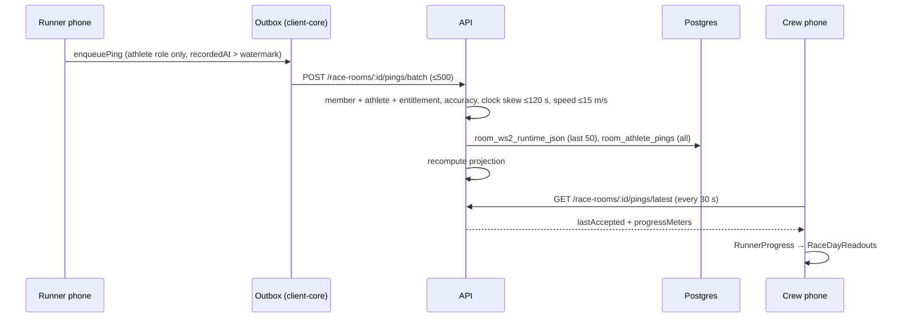

# Data flow

End-to-end paths for the flows that matter on race day. Routes and guards: [generated/api-routes.md](generated/api-routes.md). Tables: [generated/data-model.md](generated/data-model.md).

## 1. Runner location → crew readouts

The product invariant: progress comes from the **runner's phone**, never a crew phone's GPS ([AGENTS.md](../../AGENTS.md)).

1. **Capture.** iOS `RaceTrackingLocator` (Always authorization, background location mode) or Android `RaceTrackingService` (location foreground service). `PingPolicy.mayUpload` allows only the athlete role; `LocationUploadGate` throttles. On iOS, saved tracking restarts at launch from [ShellModel.swift](../../apps/ios/CrewCue/App/ShellModel.swift) (`resumeRaceTrackingAtLaunch`), because a background relaunch never shows the shell. Code: [RaceTracking.swift](../../packages/client-core/Sources/CrewCueClientCore/RaceTracking.swift), [LocationUploadGate.swift](../../packages/client-core/Sources/CrewCueClientCore/LocationUploadGate.swift).
2. **Queue.** [OutboxStore.swift](../../packages/client-core/Sources/CrewCueClientCore/OutboxStore.swift) persists pings to disk with a per-room `recordedAt` watermark. Cap 2000 pending per room; oldest dropped beyond that.
3. **Upload.** `RaceDayAPI.flushOutbox` posts batches. 422 `stale_recorded_at` → dropped; network error → stays pending; while one flush is still sending a room's pings, an overlapping flush holds that room's other pending pings for the next flush, so a newer ping cannot land first and make the backlog stale ([OutboxStore.swift](../../packages/client-core/Sources/CrewCueClientCore/OutboxStore.swift:417)); 401 → session expired ([Outbox.swift](../../packages/client-core/Sources/CrewCueClientCore/Outbox.swift)).
4. **Ingest.** `POST /race-rooms/:roomId/pings` and `/pings/batch` in [raceRooms.ts](../../services/api/src/routes/raceRooms.ts). Under the room runtime lock: monotonic `recordedAt`, speed gate, then the WS2 snapshot (last 50 pings), `room_athlete_pings` (`ON CONFLICT DO NOTHING`, so replays are idempotent; [athletePingTrack.ts](../../services/api/src/lib/athletePingTrack.ts)), projection recompute. A ping recorded before the room's `raceStartAt` is stored but never drives the projection, freshness or adopted upload interval, and is never the reference for the next ping's speed check ([raceRooms.ts](../../services/api/src/routes/raceRooms.ts:1042), [raceRooms.ts](../../services/api/src/routes/raceRooms.ts:4023); [projection.md](../api/projection.md) "Pre-start pings").
5. **Read.** `GET /race-rooms/:roomId/pings/latest` serves the in-memory last accepted ping and projected progress; a pre-start ping comes back `preStart: true` with `progressMeters: 0` ([raceRooms.ts](../../services/api/src/routes/raceRooms.ts:5317)), and client-core puts that runner at the start with no on-track call. `GET …/pings/track` pages the durable table (≤2000). Each track page carries `raceStartAt`, the start its `preStart` marks were judged against, so a client holding points read under another start rereads from the beginning ([raceRooms.ts](../../services/api/src/routes/raceRooms.ts), [index.ts](../../packages/contracts/src/index.ts)). A projection read re-seeds a stored projection that pre-start pings drove, and saves it ([raceRooms.ts](../../services/api/src/routes/raceRooms.ts:1364)).
6. **Render.** `RaceDayAPI.latestPing` → `RunnerProgress` → `RaceDayReadouts.make` ([RaceDayReadout.swift](../../packages/client-core/Sources/CrewCueClientCore/RaceDayReadout.swift)). A ping older than 15 min is stale and drops the on-track call.

## 2. Projection and pacing

- **Pre-race estimate.** `POST /pacing-estimates` ([pacingEstimates.ts](../../services/api/src/routes/pacingEstimates.ts)): `decidePlanAuthority` picks whose history counts; inputs are activity history, finished efforts, and the course-history cohort; the micro-model runs synchronously ([pacingEstimate/microModel](../../services/api/src/lib/pacingEstimate/microModel)); result saved whole, with the rooms it was computed for or attached to and its course length. For an unpaid race, and for any request without a room, the reply is finish-only (no aid ETAs, [raceTeaser.ts](../../services/api/src/lib/raceTeaser.ts:70)); an unpaid race reads its finish at the course length, not the farthest checkpoint ([pacingEstimates.ts](../../services/api/src/routes/pacingEstimates.ts)); crew on an unpaid race get 402. The route is limited to 20 an hour per user ([rateLimit.ts](../../services/api/src/plugins/rateLimit.ts:25)). `PUT /race-rooms/:roomId/course` on an unpaid race is also capped at 10 saves an hour per user, counted only when the save writes ([rateLimit.ts](../../services/api/src/plugins/rateLimit.ts:33), [raceRooms.ts](../../services/api/src/routes/raceRooms.ts:3009)).
- **Plan of record.** `PUT /race-rooms/:roomId/pacing-estimate` ([raceRoomSchedule.ts](../../services/api/src/routes/raceRoomSchedule.ts)) attaches an estimate to the room and refreshes the projection. On an unpaid race only the runner gets through, with a server-computed estimate (`pacingEstimateId`), and the reply is finish-only; an estimate tied to another unpaid race is refused ([raceRoomSchedule.ts](../../services/api/src/routes/raceRoomSchedule.ts)). The unpaid runner's schedule sheet and projection carry the start and finish rows only, with `locked` naming the withheld checkpoints; before the first accepted ping the finish is priced from the start line ([raceRooms.ts](../../services/api/src/routes/raceRooms.ts:4577)). `GET …/schedule` serves the stop schedule. Clients show each stop's clock in the viewer's local time via client-core ([ScheduleFormat.swift](../../packages/client-core/Sources/CrewCueClientCore/ScheduleFormat.swift), [DeviceTimeZone.swift](../../packages/client-core/Sources/CrewCueClientCore/DeviceTimeZone.swift)), not UTC ([schedule-sheet.md](../../clients/behavior/schedule-sheet.md)).
- **Live projection.** Each accepted ping runs `recomputeProjectionForSamples` → [raceProjection.ts](../../services/api/src/lib/raceProjection.ts). The ping is placed on the course with `geodesicProjectPointToPolylineNearProgress` ([courseMetrics.ts](../../packages/map-core/src/courseMetrics.ts:154), called at [raceProjection.ts](../../services/api/src/lib/raceProjection.ts:465)): on ground the route covers twice (loop finish, out-and-back) it picks the stretch nearest the expected progress (last progress plus time since the previous ping at the faster of rolling speed and plan pace); elsewhere it keeps the plain nearest point. A stop's first visit opens only while the runner's progress is within twice the checkpoint radius of that checkpoint's distance along the course, on either side, so the way-back twin of an out-and-back aid stop is not logged early and a start checkpoint at the finish line is not logged late ([raceProjection.ts](../../services/api/src/lib/raceProjection.ts:532)). With `PROJECTION_TUNED_CONSTANTS` on, it blends the course-history cohort ([courseHistory/resolve.ts](../../services/api/src/lib/courseHistory/resolve.ts), 5 min cache) and adds arrival windows ([arrivalWindows.ts](../../services/api/src/lib/arrivalWindows.ts)).
- **Race start.** `PATCH /race-rooms/:roomId/race-start` ([raceRooms.ts](../../services/api/src/routes/raceRooms.ts:3676)) sets or moves the start without re-sending the course, with the gates and unpaid course-save budget of `PUT …/course`. A start that moves, by that route or a course save, re-seeds or re-anchors the projection (`reanchorStartCrossing`, [raceRooms.ts](../../services/api/src/routes/raceRooms.ts:1193)) and re-anchors the plan of record's clocks ([race-rooms.md](../api/race-rooms.md)).
- **Race lock and rename.** On a paid room, the course route line and the start freeze once the runner's race pings reach the first aid station (stored once as `raceLockedAt` under the room lock; a failed write is logged and retried by the next ping) or 48 hours after `raceStartAt` (computed, never stored). A locked room answers a `PUT …/course`, `PUT …/map-workspace` or `PATCH …/race-start` that changes the route line or the start with 409 `race_locked`; a start in the 12 hours before the first aid station is still allowed. Unpaid and expired rooms are never locked ([raceLock.ts](../../services/api/src/lib/raceLock.ts), [raceRooms.ts](../../services/api/src/routes/raceRooms.ts:2822), [race-rooms.md](../api/race-rooms.md#race-lock)). `PATCH /race-rooms/:roomId` renames the race for race-setup editors and stays open on a locked race; crew read the new name on their next room or race-list read ([raceRooms.ts](../../services/api/src/routes/raceRooms.ts:3427)).
- **One finish rule.** `finishCheckpointIndex` ([raceProjection.ts](../../services/api/src/lib/raceProjection.ts:208)) picks the farthest checkpoint only when it is at the course end or marked as the finish. The projection, the schedule and the teaser all use it, and the finish ETA is the arrival at the line, without the finish checkpoint's own planned stop, so paid and unpaid finishes agree. A course with no finish checkpoint gets a route-end finish row in the schedule, its id from `routeEndFinishRowId` ([raceProjection.ts](../../services/api/src/lib/raceProjection.ts:251)). A crew check-in keeps its `visitIndex` (`nextVisitIndex`, [raceProjection.ts](../../services/api/src/lib/raceProjection.ts:67)) when auto visits are dropped. A planned stop stops counting once the runner has visited it or is past its radius along the course, so an aid station skipped between two pings does not add its stop to the finish ETA ([raceProjection.ts](../../services/api/src/lib/raceProjection.ts:675)).
- **Finish.** The first finish crossing records a finished effort and a CrewCue course-history entry, which feed later estimates.

## 3. Chat and push

The API holds first-party chat ([ADR 0011](../adr/0011-first-party-crew-chat.md)); both apps use it and the Stream routes are gone ([verify-no-vendor-chat.mjs](../../scripts/verify-no-vendor-chat.mjs)).

- **Client (iOS).** [ChatModel.swift](../../apps/ios/CrewCue/Screens/Chat/ChatModel.swift) loops on client-core `ChatSync.poll`: the first call loads the newest page, then each call long-polls with `after` and `wait=25` under a hard deadline, flushes any queued chat, and backs off 1–30 s after failures ([ChatSync.swift](../../packages/client-core/Sources/CrewCueClientCore/ChatSync.swift:41), [Deadline.swift](../../packages/client-core/Sources/CrewCueClientCore/Deadline.swift), `ChatReconnectPolicy` in [ChatThread.swift](../../packages/client-core/Sources/CrewCueClientCore/ChatThread.swift:171)). `ChatSync.send` queues the message under its `clientMessageId` (`enqueueChat`, [OutboxStore.swift](../../packages/client-core/Sources/CrewCueClientCore/OutboxStore.swift:147)) and flushes; the outbox posts it to the messages route, and 413/415 count as rejected ([Outbox.swift](../../packages/client-core/Sources/CrewCueClientCore/Outbox.swift:127)). Photos upload first, then send with the returned `photoKey`. Photos render in a fixed frame with loading and failure states, and the thread stays on the newest message ([ChatView.swift](../../apps/ios/CrewCue/Screens/Chat/ChatView.swift)).
- **Client (Android).** [ChatViewModel.kt](../../apps/android/app/src/main/kotlin/com/crewcue/android/ui/chat/ChatViewModel.kt:62) loops on the `chatPoll` bridge op, which runs the same `ChatSync.poll` and returns rows plus `retryAfterSeconds`; a failed bridge call waits 30 s. Sends, photo uploads, older pages, and discards go through `chatSend`, `chatUploadPhoto`, `chatOlder`, `chatDiscard` ([RuntimeChat.swift](../../packages/client-core/Sources/CrewCueClientCore/RuntimeChat.swift:81), [RaceDayBridge.kt](../../apps/android/app/src/main/kotlin/com/crewcue/android/data/RaceDayBridge.kt:204)). Photos use a fixed 220×165 dp frame and the thread scrolls to the newest message ([ChatPhotoLayout.kt](../../apps/android/app/src/main/kotlin/com/crewcue/android/ui/chat/ChatPhotoLayout.kt:10)). Debug builds allow cleartext to the emulator host so photo loads reach a local API ([network_security_config.xml](../../apps/android/app/src/debug/res/xml/network_security_config.xml)).

- **Paid only.** Every chat route refuses an unpaid race with 402 `room_unpaid`, the runner included, and a long-poll re-checks after its wait ([chatRoutes.ts](../../services/api/src/routes/chatRoutes.ts:101)).
- **Send.** `POST /chat/rooms/:roomId/messages` (room member; text ≤4000 chars and/or a photo key) inserts into `chat_messages`. `(room, sender, clientMessageId)` is unique, so a retry returns the first message with `duplicate: true` ([chatRoutes.ts](../../services/api/src/routes/chatRoutes.ts:302), [chatMessageStore.ts](../../services/api/src/lib/chatMessageStore.ts), [contracts](../../packages/contracts/src/index.ts:1063)). On Postgres each insert takes a per-room advisory lock inside its transaction, so ids and commit order match and a polling phone's `after` cursor cannot skip a message ([chatMessageStore.ts](../../services/api/src/lib/chatMessageStore.ts:152)). A new message wakes long-polls and schedules push.
- **Read.** `GET /chat/rooms/:roomId/messages` pages by `before`/`after` cursors (bigserial ids, ordered on the numeric `chat_messages.seq` column because the selected `seq` alias is text and would sort "100" before "99"; [chatMessageStore.ts](../../services/api/src/lib/chatMessageStore.ts:109), [chatMessageStore.ts](../../services/api/src/lib/chatMessageStore.ts:184)). With `after` and `wait` (≤25 s) it parks until a message lands, the caller is removed from the room (then 403), or the wait ends ([chatRoutes.ts](../../services/api/src/routes/chatRoutes.ts:239)). Wake-ups are in-process ([chatLive.ts](../../services/api/src/lib/chatLive.ts)); member removal publishes one, including removal by account deletion ([raceRooms.ts](../../services/api/src/routes/raceRooms.ts:3930), [raceRooms.ts](../../services/api/src/routes/raceRooms.ts:1960)).
- **Photos.** `POST /chat/rooms/:roomId/photos` takes raw JPEG/PNG/HEIC/WebP bytes up to 10 MB and returns a key scoped to room and sender; messages return presigned GET URLs that expire after 1 h ([chatRoutes.ts](../../services/api/src/routes/chatRoutes.ts:346), [chatPhotoStore.ts](../../services/api/src/lib/chatPhotoStore.ts)). Without a bucket, production answers 503; dev reads go through `GET /chat/photos/*` with a signed `exp`/`sig`.
- **Push.** Devices register with `POST /chat/devices` (alias `/chat/push/tokens`), iOS with its APNs gateway ([chatRoutes.ts](../../services/api/src/routes/chatRoutes.ts:384)); clients queue tokens through the outbox (`enqueuePush`, [OutboxStore.swift](../../packages/client-core/Sources/CrewCueClientCore/OutboxStore.swift:274)). iOS sends `apnsEnvironment` (`development` in Debug, `production` otherwise, matching [CrewCue.entitlements](../../apps/ios/CrewCue.entitlements)) and re-registers silently on sign-in when notifications are already allowed ([PushRegistrationModel.swift](../../apps/ios/CrewCue/Screens/Chat/PushRegistrationModel.swift), [ShellModel.swift](../../apps/ios/CrewCue/App/ShellModel.swift)). Tapping a chat push (`type: chat`, `roomId`) switches to that race and opens its chat ([RemoteNotifications.swift](../../apps/ios/CrewCue/App/RemoteNotifications.swift)). Android gets an FCM token (only when Firebase is configured), queues it with `enqueuePush`, re-registers on launch and on token rotation, shows foreground chat pushes itself, and routes a tap to the race's chat ([CrewPush.kt](../../apps/android/app/src/main/kotlin/com/crewcue/android/ui/chat/CrewPush.kt:70), [MainActivity.kt](../../apps/android/app/src/main/kotlin/com/crewcue/android/MainActivity.kt:49), [ShellViewModel.kt](../../apps/android/app/src/main/kotlin/com/crewcue/android/ui/ShellViewModel.kt:231)). Recipients are filtered by prefs (`all`/`mentions`/`none`) and sent through APNs (token `.p8`, HTTP/2) or FCM HTTP v1; 429/5xx retry, dead tokens are reported for deletion ([chatPushTransports.ts](../../services/api/src/lib/chatPushTransports.ts)); a device row is deleted only while it still holds the rejected token, so a fresh token registered mid-send survives ([chatPushDispatch.ts](../../services/api/src/lib/chatPushDispatch.ts), [chatPersistence.ts](../../services/api/src/lib/chatPersistence.ts)). Platforms without credentials fall back to a logging transport ([chatPushDispatch.ts](../../services/api/src/lib/chatPushDispatch.ts)). Check-in ETA alerts use the same dispatch ([checkInEtaNotify.ts](../../services/api/src/lib/checkInEtaNotify.ts)), and so do tracking reminders: a 60 s in-process tick pushes the runner of a paid, active race (only the runner) 45 and 5 minutes before `raceStartAt` when the track has no accepted ping since start − 60 min, pre-start test pings included. Each reminder is claimed once in `tracking_reminders_sent` before it is sent, so replicas don't double it, and expires when its window closes (`apns-expiration`, FCM `android.ttl`), so a phone that was offline never shows it late ([trackingReminderScheduler.ts](../../services/api/src/lib/trackingReminderScheduler.ts), [0020 migration](../../services/api/db/migrations/0020_tracking_reminders_sent.sql), [location-pings.md](../api/location-pings.md#tracking-reminders-push)). Neither app routes its `type: tracking` tap yet ([tracking-reminder.md](../../clients/behavior/tracking-reminder.md)). Setup: [chat-push.md](../runbooks/chat-push.md).
- **Retention.** A 6 h in-process interval deletes a room's messages, their bucket photos, and its prefs 30 days after `eventEndsAt` ([chatRetentionScheduler.ts](../../services/api/src/lib/chatRetentionScheduler.ts), [chatPersistence.ts](../../services/api/src/lib/chatPersistence.ts:255), [chat-retention.md](../runbooks/chat-retention.md)). The race owner can do the same with `DELETE /chat/rooms/:roomId/messages`.

## 4. Activity import, Strava, GPX, course history

- **Activity files**: `POST /activity-history/file` takes a base64 GPX, FIT, or TCX file (10 MB cap, content-hash dedupe), parsed by map-core into one activity summary ([activityHistory.ts](../../services/api/src/routes/activityHistory.ts)). This is v1's way to bring in history. For a timed track the import also stores a per-run grade profile (about 60 grade steps; built by [activityGradeProfile.ts](../../packages/map-core/src/activityGradeProfile.ts), shape in [pacingSchedule.ts](../../packages/contracts/src/pacingSchedule.ts), attached in [activityFileHistory.ts](../../services/api/src/lib/activityFileHistory.ts)). It is for the pace model only: list and ingest responses drop it (`toClientRef`, [activityHistory.ts](../../services/api/src/routes/activityHistory.ts)), and re-importing the same file adds it to a row stored before profiles existed, leaving the row's other fields alone ([activityHistoryStore.ts](../../services/api/src/lib/activityHistoryStore.ts)). Nothing in the estimate reads it yet. Two more routes take a file or a `.zip` (20 MB, up to 500 entries, 200 MB unpacked, read by [zipArchive.ts](../../services/api/src/lib/zipArchive.ts)): `POST /activity-history/preview` reads each run without saving (stats, a 200-point route line, and whether it is already imported), and `POST /activity-history/archive` imports every `.gpx`/`.fit`/`.tcx` in it with the same rows and dedupe as `/file`; other entries come back as unreadable ([activityHistory.ts](../../services/api/src/routes/activityHistory.ts)). Pacing history is runs and hikes: map-core reads the sport from the file (FIT session, TCX `Sport`, GPX `<type>`; unknown counts as a run) and the import refuses a ride or other sport ([activityFile.ts](../../packages/map-core/src/activityFile.ts), [activityFileHistory.ts](../../services/api/src/lib/activityFileHistory.ts)). Sharing a file to the app uses the same two routes: iOS lists CrewCue as an "Open in" target ([Info.plist](../../apps/ios/CrewCue/Info.plist)) and Android as a VIEW/SEND target ([AndroidManifest.xml](../../apps/android/app/src/main/AndroidManifest.xml)); a sheet previews the file, then imports on confirm, and signed out it drops the file without uploading. Copy and state are client-core [SharedRunImport.swift](../../packages/client-core/Sources/CrewCueClientCore/SharedRunImport.swift); the sheets are [SharedRunImportSheet.swift](../../apps/ios/CrewCue/Screens/ActivityImport/SharedRunImportSheet.swift) and [SharedRunImport.kt](../../apps/android/app/src/main/kotlin/com/crewcue/android/ui/activity/SharedRunImport.kt). Spec: [run-share-import.md](../../clients/behavior/run-share-import.md). iOS: Settings → Past runs picks a file, checks it locally, then calls `RaceDayAPI.importActivityFile` and reloads `activityHistoryItems` ([ActivityImportModel.swift](../../apps/ios/CrewCue/Screens/ActivityImport/ActivityImportModel.swift), [RaceDayAPI.swift](../../packages/client-core/Sources/CrewCueClientCore/RaceDayAPI.swift:183)); Android: Settings → Past runs opens the system document picker, reads at most one byte past the size limit (so client-core reports an oversized file), then calls the `importActivityFile` and `activityHistoryItems` bridge ops ([ActivityImportSection.kt](../../apps/android/app/src/main/kotlin/com/crewcue/android/ui/activity/ActivityImportSection.kt:94), [RaceDayBridge.kt](../../apps/android/app/src/main/kotlin/com/crewcue/android/data/RaceDayBridge.kt:261), [RuntimeBridge.swift](../../packages/client-core/Sources/CrewCueClientCore/RuntimeBridge.swift:1475)).
- **Strava** (off in v1 clients behind `ClientFeatureFlags.stravaEnabled`; on Android behind `BuildConfig.STRAVA_ENABLED`, on only with `-Pcrewcue.strava=true` ([build.gradle.kts](../../apps/android/app/build.gradle.kts:79), [SettingsSheet.kt](../../apps/android/app/src/main/kotlin/com/crewcue/android/ui/settings/SettingsSheet.kt:63); API routes still live) ([stravaRoutes.ts](../../services/api/src/routes/stravaRoutes.ts)): OAuth with a per-user state; `/strava/oauth/redirect` bounces to the `crewcue://strava` deep link; the callback stores tokens; `/strava/oauth/start`, `/strava/oauth/callback` and `/strava/connection` are rate limited per user ([rateLimit.ts](../../services/api/src/plugins/rateLimit.ts)) because each call can reach Strava's per-app quota; `/strava/sync` refreshes and upserts activities into activity history.
- **GPX**: `/activity-history/gpx` and `/course/gpx-preview` take up to 10 MB ([gpxLimits.ts](../../services/api/src/lib/gpxLimits.ts)); parsed synchronously in [map-core courseParse.ts](../../packages/map-core/src/courseParse.ts). Clients queue imports in the outbox.
- **Course line on the iOS map.** The map reads the room's saved GPX line from `GET /race-rooms/:roomId` via [CourseRouteLine.swift](../../packages/client-core/Sources/CrewCueClientCore/CourseRouteLine.swift) (`mapWorkspace` vertices) and draws it, falling back to joining the checkpoints when fewer than two vertices exist. The line is cached offline with the checkpoints ([MapModel.swift](../../apps/ios/CrewCue/Screens/Map/MapModel.swift:697)). Base map styles are all OpenFreeMap, chosen per phone ([MapBaseStyle.swift](../../apps/ios/CrewCue/Screens/Map/MapBaseStyle.swift)).
- **Course history**: OpenSplitTime results come in through operator scripts ([sources/openSplitTime.ts](../../services/api/src/lib/courseHistory/sources/openSplitTime.ts)); `COURSE_HISTORY_PRODUCT_SOURCES` picks which sources the product uses.

## 5. Rooms, invites, join

- **Create**: `POST /race-rooms` with `Idempotency-Key`; room id derived from sub + key. The creator becomes the first member with the role they choose. A creator who already made 3 races still `unpaid` (never paid) gets 409 `unpaid_race_limit`, counted from the stored rooms ([billingEntitlement.ts](../../services/api/src/lib/billingEntitlement.ts), [0021 migration](../../services/api/db/migrations/0021_unpaid_race_rooms.sql), [race-rooms.md](../api/race-rooms.md#unpaid-races-at-most-3-deleted-after-30-days)). The creator of a never-paid race gets `type: unlock` pushes 7 days and 1 day before it is deleted and 3 days before its start, each claimed once in `unpaid_reminders_sent` ([unpaidRaceReminderScheduler.ts](../../services/api/src/lib/unpaidRaceReminderScheduler.ts), [0023 migration](../../services/api/db/migrations/0023_unpaid_reminders_sent.sql)); an hourly sweeper deletes the race 30 days after `createdAt`, and no sooner than 24 hours after the 1-day reminder's claim, with the same delete account deletion uses ([unpaidRaceExpiryScheduler.ts](../../services/api/src/lib/unpaidRaceExpiryScheduler.ts), [raceRoomDeletion.ts](../../services/api/src/lib/raceRoomDeletion.ts)). `GET /race-rooms/:roomId` and `/mine` carry `unpaidExpiresAt` on such a race ([race-rooms.md](../api/race-rooms.md#unpaid-races-at-most-3-deleted-after-30-days)).
- **Invite**: an inviter (athlete, crew chief, team manager) creates a UUID token, 24 h default and 7 days at most (an `expiresAt` in the past or beyond that gets 400; [raceRooms.ts](../../services/api/src/routes/raceRooms.ts:2423)). Only the race owner (the room's `athleteId`) may invite above `crew_member`; any other issuer gets 403 ([raceRooms.ts](../../services/api/src/routes/raceRooms.ts:3146)). Accept adds or changes the caller's membership under the room lock. An invite lapses (410) once its issuer is no longer the race owner or a member who may invite ([raceRooms.ts](../../services/api/src/routes/raceRooms.ts:2427)).
- **Join by code**: any signed-in user with the 6-digit code joins as `crew_member`, unless the race owner removed them: that join answers 404, like an unknown code ([raceRooms.ts](../../services/api/src/routes/raceRooms.ts:3975)). `GET /race-rooms/join-preview/:roomCode` is public and rate-limited per IP.
- **Delete**: `DELETE /race-rooms/:roomId` is for the race owner only (the room's `athleteId`; 401 signed out, 404 unknown, 403 otherwise). It runs the same full delete as account deletion and the unpaid sweeper, then wakes the crew's chat long-polls ([raceRooms.ts](../../services/api/src/routes/raceRooms.ts:4367), [raceRoomDeletion.ts](../../services/api/src/lib/raceRoomDeletion.ts)). Clients call `RaceDayAPI.deleteRace` through `RaceDeletion.run`, which treats a 404 as already deleted and maps 403 and offline to messages ([RaceDeletion.swift](../../packages/client-core/Sources/CrewCueClientCore/RaceDeletion.swift:41), [RaceDayAPI.swift](../../packages/client-core/Sources/CrewCueClientCore/RaceDayAPI.swift:209)). iOS asks for a confirm in Profile; deleting the active race asks which race next ([ProfileModel.swift](../../apps/ios/CrewCue/Screens/Profile/ProfileModel.swift:68), [ShellModel.swift](../../apps/ios/CrewCue/App/ShellModel.swift:520)). Spec: [race-delete.md](../../clients/behavior/race-delete.md); the `race-delete` row is `fail` on both platforms ([deeplinks.json](../../clients/behavior/deeplinks.json)).
- **Removal**: `DELETE /race-rooms/:roomId/members/:memberUserId` first records the removal in `room_removed_members`, which the room payload never shows ([roomRemovalStore.ts](../../services/api/src/lib/roomRemovalStore.ts:15), [raceRooms.ts](../../services/api/src/routes/raceRooms.ts:4173), [data-model.md](generated/data-model.md)). Only an invite the race owner issued after the removal readmits them (403 otherwise), and accepting it clears the record ([raceRooms.ts](../../services/api/src/routes/raceRooms.ts:2437)).
- **Invite link and pending join**: the join page is `https://collinbrowse.github.io/crewcue/join/?code=<6 digits>`; `crewcue://join/<code>` and the Play install referrer carry the same code ([InviteLink.swift](../../packages/client-core/Sources/CrewCueClientCore/InviteLink.swift:23)). A code read from a link is saved as the device's one pending join. It expires after seven days and belongs to one user: another account's read removes it ([PendingJoin.swift](../../packages/client-core/Sources/CrewCueClientCore/PendingJoin.swift:177)). Joining it calls `POST /race-rooms/join-by-code`. Joined, already a member, and an unknown or malformed code clear it; a full crew (409), an unpaid race (402), offline, signed out, and other failures keep it for a retry ([PendingJoin.swift](../../packages/client-core/Sources/CrewCueClientCore/PendingJoin.swift:84)). The runtime ops are in [RuntimeOnboarding.swift](../../packages/client-core/Sources/CrewCueClientCore/RuntimeOnboarding.swift:27). On iOS, [ShellModel.swift](../../apps/ios/CrewCue/App/ShellModel.swift:420) sends every opened URL through `InviteLink.route` ([InviteRoute.swift](../../packages/client-core/Sources/CrewCueClientCore/InviteRoute.swift:16)) before the Debug-only `crewcue://dev/*` routes; a join link with no readable code offers Paste invite code. A signed-out confirmation (Sign up to join) joins on sign-in only within 30 minutes ([OnboardingStore.swift](../../packages/client-core/Sources/CrewCueClientCore/OnboardingStore.swift:25), [InviteRoute.swift](../../packages/client-core/Sources/CrewCueClientCore/InviteRoute.swift:41)), and giving the invite up clears it ([InviteRoute.swift](../../packages/client-core/Sources/CrewCueClientCore/InviteRoute.swift:52)). Hosting the page and link files is an owner task ([launch-owner-setup.md](../runbooks/launch-owner-setup.md), "Invite links").
- **Crew cap**: new rooms start `unpaid` with crew tier `one`. Rooms stored before billing have no tier and count as unlimited. The runner and the room's creator do not take the crew seat. Past the cap, crew invites, invite accepts, and code joins answer 409 `crew_limit_reached`; accepts and joins check under the room lock. On an unpaid race every invite is refused with 402 `room_unpaid`, and an accept or join can only take the runner's own seat; the public join preview drops the plan curve ([raceRooms.ts](../../services/api/src/routes/raceRooms.ts:3198), [raceRooms.ts](../../services/api/src/routes/raceRooms.ts:664)). Existing members are never removed ([raceRooms.ts](../../services/api/src/routes/raceRooms.ts:3155), [billingEntitlement.ts](../../services/api/src/lib/billingEntitlement.ts:29)).

## 6. Auth

Auth0 web sign-in on the phone → access token → `Authorization: Bearer` on every client-core request → API verifies against Auth0 JWKS → `request.identity` = {sub, email, teamIds, roomRoles} ([authIdentity.ts](../../services/api/src/lib/authIdentity.ts)). No refresh token on the clients today; a 401 expires the session and wipes per-user stores. At launch `SessionVaultLaunch.restore` wipes the vault on a fresh install, moves a legacy plaintext `session.json` into the vault and deletes it, and keeps the session when the vault is only temporarily unavailable ([SessionVault.swift](../../packages/client-core/Sources/CrewCueClientCore/SessionVault.swift:58)).

## 7. Account deletion

Settings → Delete account → confirm → `AccountDeletion.run` → `RaceDayAPI.deleteAccount` → `DELETE /me` ([AccountDeletion.swift](../../packages/client-core/Sources/CrewCueClientCore/AccountDeletion.swift), [RaceDayAPI.swift](../../packages/client-core/Sources/CrewCueClientCore/RaceDayAPI.swift:475), [accountRoutes.ts](../../services/api/src/routes/accountRoutes.ts:17)). Only a confirmed delete signs the app out, which wipes the session, outbox and per-user caches; `run` also removes the user's onboarding progress file, which sign-out keeps ([AccountDeletion.swift](../../packages/client-core/Sources/CrewCueClientCore/AccountDeletion.swift:48)), and a failed removal is only logged; offline, 502 (data gone, Auth0 login not removed) and other failures keep the user signed in to retry. iOS calls it from [AccountDeletionModel.swift](../../apps/ios/CrewCue/Screens/Settings/AccountDeletionModel.swift); Android calls it from the Settings Account card ([AccountDeletion.kt](../../apps/android/app/src/main/kotlin/com/crewcue/android/ui/settings/AccountDeletion.kt:99), [SettingsSheet.kt](../../apps/android/app/src/main/kotlin/com/crewcue/android/ui/settings/SettingsSheet.kt:78)) through the `deleteAccount` bridge op and takes its strings from the `accountDeletionCopy` op ([RaceDayBridge.kt](../../apps/android/app/src/main/kotlin/com/crewcue/android/data/RaceDayBridge.kt:286), [RuntimeBridge.swift](../../packages/client-core/Sources/CrewCueClientCore/RuntimeBridge.swift:256)); neither app links to a web deletion page. Spec: [account-deletion.md](../../clients/behavior/account-deletion.md). On the server, rooms the user owns lose their chat messages and photos; every message the user sent in any room goes with its photo, as do their push devices and prefs ([accountDeletion.ts](../../services/api/src/lib/accountDeletion.ts:101), [chatPersistence.ts](../../services/api/src/lib/chatPersistence.ts:290), [chatMessageStore.ts](../../services/api/src/lib/chatMessageStore.ts:251)). There is no third-party chat user to delete any more. Each race the user owns is removed with its pings, chat and history through the shared delete ([accountDeletion.ts](../../services/api/src/lib/accountDeletion.ts:80), [raceRoomDeletion.ts](../../services/api/src/lib/raceRoomDeletion.ts)). Billing grants stay for refunds and store reconciliation; only their link to the user is removed (`anonymizeBillingForUser`, [accountDeletion.ts](../../services/api/src/lib/accountDeletion.ts:95), [billingStore.ts](../../services/api/src/lib/billingStore.ts:237)).

## 8. Onboarding and demo replay

- **Onboarding state.** client-core decides the flow for both apps: `readOnboarding` takes the signed-in flag, any pending invite, the `myRaces` rows and the active room, and answers a state; `markOnboardingStep` records a step; `resetOnboarding` forgets one ([RuntimeOnboarding.swift](../../packages/client-core/Sources/CrewCueClientCore/RuntimeOnboarding.swift:5), [Onboarding.swift](../../packages/client-core/Sources/CrewCueClientCore/Onboarding.swift)). With no race list yet, the state follows the last saved list, or is `loading`. A crew member's unpaid race answers `raceLocked` with no tour.
- **Onboarding copy.** Both apps take step wording from client-core `OnboardingCopy`; Android reads it through the `onboardingCopy` bridge op, and `onboardingHistoryComparison` returns the with/without-history finish line or null to hide it ([OnboardingCopy.swift](../../packages/client-core/Sources/CrewCueClientCore/OnboardingCopy.swift), [RuntimeBridge.swift](../../packages/client-core/Sources/CrewCueClientCore/RuntimeBridge.swift:258)).
- **Runner setup.** For a new runner the iOS shell opens [RunnerSetupModel.swift](../../apps/ios/CrewCue/Screens/Onboarding/RunnerSetupModel.swift) from the onboarding state ([ShellModel.swift](../../apps/ios/CrewCue/App/ShellModel.swift)). Its steps run through client-core [RunnerSetupSteps.swift](../../packages/client-core/Sources/CrewCueClientCore/RunnerSetupSteps.swift), so Back keeps what was entered and Continue saves only what changed. It asks for a race name first and creates the race with it (never named after the course file; with no name the step asks again, `raceNameMissing` in [OnboardingSetup.swift](../../packages/client-core/Sources/CrewCueClientCore/OnboardingSetup.swift)), previews the picked GPX through `POST /race-rooms/:roomId/course/gpx-preview` (client-core `CoursePreview`, [OnboardingSetup.swift](../../packages/client-core/Sources/CrewCueClientCore/OnboardingSetup.swift)), saves the start alone with `RaceDayAPI.updateRaceStart` (`PATCH …/race-start`, [RaceDayAPI.swift](../../packages/client-core/Sources/CrewCueClientCore/RaceDayAPI.swift)) and the course (`PUT …/course`) only when a new file was picked or none exists, and ends on the unpaid teaser. On the history step, Continue keeps an estimate the race already has (`OnboardingRace.hasEstimate` from the race list) with no request, even on a phone with no setup progress, and marks the step done ([RunnerSetupSteps.swift](../../packages/client-core/Sources/CrewCueClientCore/RunnerSetupSteps.swift), [Onboarding.swift](../../packages/client-core/Sources/CrewCueClientCore/Onboarding.swift)). A queued course upload the server throttles (429) stays pending and waits out a backoff of 2 minutes, doubling to 30 ([Outbox.swift](../../packages/client-core/Sources/CrewCueClientCore/Outbox.swift), [OutboxStore.swift](../../packages/client-core/Sources/CrewCueClientCore/OutboxStore.swift)); the backoff is memory only, so a relaunch tries once more. Android runs the same flow in [RunnerSetupViewModel.kt](../../apps/android/app/src/main/kotlin/com/crewcue/android/ui/onboarding/RunnerSetupViewModel.kt) through the `raceStartInput`, `gpxPreview`, `raceAccess`, `runnerSetupStep` and `updateRaceStart` bridge ops, so Back and save-only-what-changed come from the same `RunnerSetupSteps` ([RuntimeRunnerSetup.swift](../../packages/client-core/Sources/CrewCueClientCore/RuntimeRunnerSetup.swift)); `RaceAccess` decides, for both apps, whether an unpaid race loads, pings or shows the Unlock banner ([RaceAccess.swift](../../packages/client-core/Sources/CrewCueClientCore/RaceAccess.swift:7)). `onboarding-runner-setup` passes on both platforms ([deeplinks.json](../../clients/behavior/deeplinks.json)).
- **Storage.** One JSON file per user id, plus a guest file for the signed-out user that the next sign-in adopts. The directory sits beside the storage root, so sign-out and sign-in wipes leave it; only account deletion removes it ([OnboardingStore.swift](../../packages/client-core/Sources/CrewCueClientCore/OnboardingStore.swift:199), [AppDirectories.swift](../../apps/ios/CrewCue/App/AppDirectories.swift)).
- **Demo replay.** `demoRaceCreate` builds a scripted race of about 25 s behind its own base URL. Race-day ops pointed at that URL read the scripted transport and clock, with no token, no outbox and no location tracking ([RuntimeDemoRace.swift](../../packages/client-core/Sources/CrewCueClientCore/RuntimeDemoRace.swift:45), [DemoRacePlayer.swift](../../packages/client-core/Sources/CrewCueClientCore/DemoRacePlayer.swift:19), [RuntimeBridge.swift](../../packages/client-core/Sources/CrewCueClientCore/RuntimeBridge.swift:312)). Its caches live in a temporary directory deleted on finish or skip; `demoRaceCleanup` sweeps leftovers at launch. It is not runner progress and never reads `GET …/pings/latest`. `demoRaceSeek` jumps the replay to a point in the script, and `demoRaceRunner` answers where the runner's dot is on the course line at the replay clock, so a screen can glide it between updates ([RuntimeDemoRace.swift](../../packages/client-core/Sources/CrewCueClientCore/RuntimeDemoRace.swift), `DemoRacePlayer.runnerPosition`); Android's map asks for it on every frame during the replay ([RaceDayBridge.kt](../../apps/android/app/src/main/kotlin/com/crewcue/android/data/RaceDayBridge.kt:518), [RunnerGlide.kt](../../apps/android/app/src/main/kotlin/com/crewcue/android/ui/map/RunnerGlide.kt)). The path the replay serves runs along the course line: between two pings it adds the line's vertices and a point at least every 100 m ([DemoRaceScript.swift](../../packages/client-core/Sources/CrewCueClientCore/DemoRaceScript.swift)); a replay that can't start returns the checklist state in the failure JSON ([RuntimeBridge.swift](../../packages/client-core/Sources/CrewCueClientCore/RuntimeBridge.swift)).
- **Race-day replay (iOS).** After the teaser the onboarding gate shows the runner's own race as the replay ([RacePreviewModel.swift](../../apps/ios/CrewCue/Screens/Onboarding/RacePreviewModel.swift), [ShellModel.swift](../../apps/ios/CrewCue/App/ShellModel.swift)). It reads the room body with `RaceDayAPI.loadRoomData` (`GET /race-rooms/:roomId`, kept raw so the map workspace survives; [RaceDayAPI.swift](../../packages/client-core/Sources/CrewCueClientCore/RaceDayAPI.swift:158)), saves a copy as `replay-room.json` in the room's directory, and falls back to it offline. Its map and pace models take `ModelStorage.replay`, the replay's temporary directories, not the app's ([ModelStorage.swift](../../apps/ios/CrewCue/App/ModelStorage.swift:23)). `DemoRaceAudience` counts the views showing it, so it pauses and cleans up only when the last one goes ([DemoRaceAudience.swift](../../packages/client-core/Sources/CrewCueClientCore/DemoRaceAudience.swift)). Not now marks the step skipped and leaves the race unpaid; a purchase reloads the race list, then marks it done ([ShellModel.swift](../../apps/ios/CrewCue/App/ShellModel.swift)). The dev link `crewcue://dev/onboarding-race-preview` plays `DemoRaceFixture` with no API, and `?at=&paused=` seeks it ([DemoRaceFixture.swift](../../packages/client-core/Sources/CrewCueClientCore/DemoRaceFixture.swift), [DemoRacePlayer.swift](../../packages/client-core/Sources/CrewCueClientCore/DemoRacePlayer.swift:122)). Android has no replay screen yet ([deeplinks.json](../../clients/behavior/deeplinks.json)).

## 9. Billing

The runner pays per race; crew never pay ([billing.md](../api/billing.md)). Products are consumables: `race_pass` (runner + 1 crew), `crew_upgrade` (unlimited crew once the room has a pass), `race_pass_full_crew` ([billingEntitlement.ts](../../services/api/src/lib/billingEntitlement.ts:16)).

1. **Buy.** The app sets the RevenueCat subscriber attribute `crewcue_room_id` to the room and buys through the store ([RevenueCatPurchaser.swift](../../apps/ios/CrewCue/App/RevenueCatPurchaser.swift:31), [RevenueCatPurchaser.kt](../../apps/android/app/src/main/kotlin/com/crewcue/android/billing/RevenueCatPurchaser.kt:66)). The apps never mark a room paid.
2. **Webhook.** `POST /billing/revenuecat` checks the `Authorization` header against `REVENUECAT_WEBHOOK_AUTH` (503 when unset), records the delivery by event id so redeliveries of a finished delivery are no-ops (a record still at `received`, never finished, is taken again on retry; [billingStore.ts](../../services/api/src/lib/billingStore.ts:90)), and maps purchase events to grants and `CANCELLATION`/`EXPIRATION` to revokes ([billingRoutes.ts](../../services/api/src/routes/billingRoutes.ts:99), [billingEntitlement.ts](../../services/api/src/lib/billingEntitlement.ts:156)). A purchase with no room attribute, or an unknown room, is stored with `room_id` null and logged as `billing_webhook_unknown_room`, never applied ([billingRoutes.ts](../../services/api/src/routes/billingRoutes.ts:138)). If applying fails, the delivery record is dropped so RevenueCat's retry applies it.
3. **Apply.** Under the room lock, the grant is upserted by transaction id and the room's entitlement is recomputed from all its grants: an active pass makes it `paid`, a pass plus Full Crew makes the tier `unlimited`, a refund drops it back ([billingRoutes.ts](../../services/api/src/routes/billingRoutes.ts:45), [billingEntitlement.ts](../../services/api/src/lib/billingEntitlement.ts:114)).
4. **Confirm.** After the store reports a purchase, client-core polls `GET /race-rooms/:roomId/billing` (20 reads, 2 s apart) until the room has the product. If the webhook has not landed by then, the purchase ends `pending`, not failed ([Billing.swift](../../packages/client-core/Sources/CrewCueClientCore/Billing.swift:127), [Billing.swift](../../packages/client-core/Sources/CrewCueClientCore/Billing.swift:222)). Android runs the same flow through the `billing` and purchase bridge ops ([RuntimeBridge.swift](../../packages/client-core/Sources/CrewCueClientCore/RuntimeBridge.swift:122), [RaceDayBridge.kt](../../apps/android/app/src/main/kotlin/com/crewcue/android/data/RaceDayBridge.kt:318)).
5. **Comp.** Race directors' rooms are comped with `npm run billing:comp`, which calls `POST /billing/admin/comp` with a server secret the apps never hold ([billing-comp.mjs](../../scripts/billing-comp.mjs), [billingRoutes.ts](../../services/api/src/routes/billingRoutes.ts:210)).
